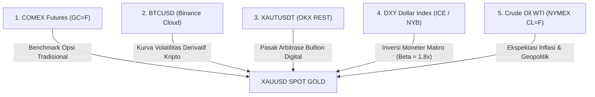

# Gamma Exposure (GEX) & Direct Market Terminal

Sistem pengumpul data pasar terpadu (*real-time collector*) dan analisis eksposur gamma lintas pasar (*Cross-Market Gamma Exposure / GEX*) berbasis teks tanpa chart visual (*zero-chart overhead*).

---

## 1. Arsitektur Komponen Sistem

```
┌────────────────────────────────────────────────────────┐
│               MetaTrader 5 (MT5 Terminal)              │
│       Expert Advisor: "multi port bridge EA.mq5"       │
│               [Port 1: 5555 | Port 2: 5556]            │
└──────────────────────────┬─────────────────────────────┘
                           │ TCP Socket Stream (Port 5556)
                           ▼
┌────────────────────────────────────────────────────────┐
│         Python GEX & Market Engine (Localhost)         │
│  - TCP Listener Port 5556 (XAUUSD Live Ticks)          │
│  - Direct Crawler: GC=F, BTCUSDT, XAUTUSDT, DXY, CL=F  │
│  - Cross-Asset Multi-Pillar GEX Analytical Engine      │
└──────────────────────────┬─────────────────────────────┘
                           │
                           ▼
┌────────────────────────────────────────────────────────┐
│           Pure Text-Based HUD / Terminal               │
│  - Pantauan Harga Live Real-Time                       │
│  - Matriks GEX Terstandarisasi Warna (Call/Flip/Put)   │
│  - Frameless, Taskbar-Integrated, Ultra Low Latency    │
└────────────────────────────────────────────────────────┘
```

---

## 2. Model 5 Pilar GEX untuk XAUUSD (Spot Gold)

Secara konvensional, Gamma Exposure (GEX) hanya dihitung dari kontrak opsi emas CME (COMEX Gold Options). Namun sistem ini mengimplementasikan **Cross-Asset Multi-Pillar Custom GEX** yang memadukan 5 pilar pasar keuangan global untuk memetakan level magnet likuiditas dan dinding lindung nilai (*hedging walls*) dealer:



### Rincian 5 Pilar:

1. **Pilar 1: COMEX Gold Futures (`GC=F`) [Benchmark Tradisional]**:
   * Menghitung **Call Wall** (resistensi magnetik), **Put Wall** (lantai support dealer), dan **Gamma Flip** pasar berjangka CME.
   * Net Dollar GEX ($M per 1% move).

2. **Pilar 2: BTCUSD [Crypto Derivative Curvature]**:
   * Menghitung **BTC-Induced Gamma Flip** pada skala harga emas.
   * Menentukan **Call/Put Walls pada Emas** yang terinduksi oleh posisi dealer derivatif Bitcoin (grid strike per $2,500).
   * Mengukur risiko *convexity spillover* dan aliran re-hedging dealer delta-netral.

3. **Pilar 3: XAUTUSDT [Tether Gold Peg Arbitrage]**:
   * Mengukur *basis peg spread* dan stabilitas pasak emas fisik vs token kripto.
   * Menghitung **Peg Gamma Flip Level** dan dinding arbitrase dealer (*Arbitrage Call/Put Walls*).

4. **Pilar 4: DXY Dollar Index (`DX-Y.NYB`) [Inversi Moneter Makro]**:
   * **Hukum Inversi Gamma (*Inverse Gamma Law*)**:
     Karena XAUUSD adalah rasio Emas/USD, maka batas pergerakan Dollar bekerja secara terbalik terhadap Emas:
     * **DXY Call Wall (Resistensi USD)** $\rightarrow$ Menjadi **XAUUSD Put Wall (Lantai Support Emas)**.
     * **DXY Put Wall (Support USD)** $\rightarrow$ Menjadi **XAUUSD Call Wall (Plafon Emas)**.
     * **DXY Gamma Flip** $\rightarrow$ Titik balik akselerasi mata uang. Saat DXY jatuh ke area negatif GEX, pelarian likuiditas memicu akselerasi beli pada XAUUSD.
   * Menggunakan koefisien elastisitas makro $\beta \approx 1.8\text{x}$.

5. **Pilar 5: Crude Oil WTI (`CL=F`) [Komoditas Energi & Ekspektasi Inflasi]**:
   * Minyak mentah adalah komponen nomor satu pembentuk inflasi global (Headline CPI). Kenaikan minyak menekan *real yields* obligasi dan mendorong minat lindung nilai emas.
   * Menggunakan proyeksi **Gold-to-Oil Ratio (G/O Ratio)** ($\approx 1\text{ oz Gold} / 1\text{ bbl Oil}$) untuk memetakan strike opsi energi NYMEX ($5.00 interval) ke skala harga emas spot.
   * Mengukur rejim *Geopolitical Shock Spillover* saat volatilitas energi melonjak mendadak.

---

## 3. Standarisasi Tampilan Metrik & Warna

Semua mode di terminal mengikuti hierarki warna yang telah distandarisasi secara ketat:
* **Call Wall**: **Merah** (`#f85149`) — Batas resistensi atas dealer opsi.
* **Gamma Flip Level**: **Putih Bold** (`#ffffff`) — Level netral pembalik rejim volatilitas.
* **Put Wall**: **Hijau** (`#3fb950`) — Batas support bawah dealer opsi.

Masing-masing metrik disajikan secara terpisah pada barisnya sendiri lengkap dengan estimasi **Notional Volume ($M)**:
```text
   • Call Wall        : $... (Vol: $...M)   [MERAH]
   • Gamma Flip Level : $... (Vol: $...M)   [PUTIH BOLD]
   • Put Wall         : $... (Vol: $...M)   [HIJAU]
   • Net Dollar GEX   : $...M per 1% move
```

---

## 4. Spesifikasi Mode Layar Terminal

Terminal HUD dirancang dengan prinsip **Zero Cross-Clutter**: layar hanya menyajikan informasi yang relevan dengan mode yang dipilih pengguna.

### A. Mode 1: XAUUSD (Spot Gold)
Menampilkan analisis multi-pilar terhadap emas spot, dilengkapi tabel riset perbandingan dinding & flip di bagian bawah:
```text
>> MODE: XAUUSD (SPOT GOLD) [MT5 LIVE STREAM]
Spot: $2,745.20 │ Bid: $2,745.05 │ Ask: $2,745.35 │ Spread: $0.30 │ Vol: 1.00

1. GOLD FUTURES (Yahoo GC=F / CME Ref: $2,746.50)
   • Basis vs Futures : -$1.30 │ Regime: [+GEX POSITIVE] LONG GAMMA
   • Call Wall        : $2,775.00 (Vol: $32.40M)   [MERAH]
   • Gamma Flip Level : $2,740.00 (Vol: $11.20M)   [PUTIH BOLD]
   • Put Wall         : $2,725.00 (Vol: $28.50M)   [HIJAU]
   • Net Dollar GEX   : +$22.80M per 1% move

2. BTCUSD (Binance Cloud Mirror: $80,639.12)
   • 24H Change       : +0.79% │ Rasio: 29.37x │ Regime: [+GEX BTC] VOLATILITY DAMPENER
   • Call Wall        : $2,785.00 (Vol: $18.20M)   [MERAH]
   • Gamma Flip Level : $2,738.50 (Vol: $7.90M)    [PUTIH BOLD]
   • Put Wall         : $2,710.00 (Vol: $16.40M)   [HIJAU]
   • Net Dollar GEX   : +$16.20M per 1% move

3. XAUTUSDT (OKX Market REST: $4,059.80)
   • Spread vs Spot   : -$14.60 (-0.53%) │ Regime: [+GEX XAUT] TIGHT PEG ARBITRAGE
   • Call Wall        : $2,760.00 (Vol: $12.50M)   [MERAH]
   • Gamma Flip Level : $2,745.00 (Vol: $5.80M)    [PUTIH BOLD]
   • Put Wall         : $2,730.00 (Vol: $10.90M)   [HIJAU]
   • Net Dollar GEX   : +$11.10M per 1% move

────────────────────────────────────────────────────────────────────────────────────
[RISET PERBANDINGAN WALLS & FLIP - SKALA XAUUSD]
INSTRUMEN     │ CALL WALL (VOL)        │ GAMMA FLIP (VOL)       │ PUT WALL (VOL)
──────────────┼────────────────────────┼────────────────────────┼───────────────────
1. GC=F GOLD  │ $2,775.00 ($32.4M)     │ $2,740.00 ($11.2M)     │ $2,725.00 ($28.5M)
2. BTC/USDT   │ $2,785.00 ($18.2M)     │ $2,738.50 ($7.9M)      │ $2,710.00 ($16.4M)
3. XAUT/USDT  │ $2,760.00 ($12.5M)     │ $2,745.00 ($5.8M)      │ $2,730.00 ($10.9M)
```

---

### B. Mode 2: BTCUSD (Bitcoin)
Secara khusus berfokus pada **BTCUSD - GEX dari XAUTUSDT**:
```text
>> MODE: BTCUSD
Spot: $80,639.12 │ 24H Change: +0.79% ▲

BTCUSD - GEX DARI XAUTUSDT
   • XAUT Spot Price  : $4,059.80 │ Rasio: 19.86 XAUT/BTC
   • Gamma Regime     : [+GEX] BALANCED ROTATION
   • Call Wall        : $82,500.00 (Vol: $143.70M)  [MERAH]
   • Gamma Flip Level : $78,500.00 (Vol: $59.63M)   [PUTIH BOLD]
   • Put Wall         : $77,500.00 (Vol: $120.25M)  [HIJAU]
   • Net Dollar GEX   : +$822.52M per 1% move
   • Capital Rotation : BALANCED RE-HEDGING (Rotasi Portofolio Normal)
   • Hedging Trigger  : Jika BTC < $77,800.00
```

---

### C. Mode 3: XAUTUSDT (Tether Gold)
Secara khusus berfokus pada **GEX DARI BTCUSD**:
```text
>> MODE: XAUTUSDT
Spot: $4,059.80 │ 24H Change: +1.17% ▲

GEX DARI BTCUSD
   • BTC Spot Price   : $80,660.00 (+0.81%)
   • Gamma Regime     : [+GEX] STEADY VALUE ABSORPTION
   • Call Wall        : $4,075.00 (Vol: $21.57M)   [MERAH]
   • Gamma Flip Level : $4,035.00 (Vol: $7.76M)    [PUTIH BOLD]
   • Put Wall         : $4,025.00 (Vol: $17.75M)   [HIJAU]
   • Net Dollar GEX   : +$15.63M per 1% move
   • Volatility State : NORMAL / COMPRESSED
   • Rotational Bias  : STEADY ACCUMULATION
```

---

## 5. Komponen Multi-Port Bridge EA (`multi port bridge EA.mq5`)

EA MQL5 kustom yang mampu menyiarkan tick order flow ke hingga 5 port TCP secara paralel:
* **Port 5552**: Dedicated Port untuk TickMap Bridge (`Tick Map`).
* **Port 5556**: Dedicated Port untuk Gamma Exposure Terminal (`Gamma Exposure`).
* **Port 5557 - 5559**: Port cadangan tambahan.
* **Karakteristik**:
  * *Fault-tolerant*: Jika salah satu port aplikasi terputus, port lain tetap berjalan tanpa gangguan.
  * *Non-blocking*: Timeout koneksi 300 ms (mencegah chart MT5 membeku).
  * *Integrated Chart HUD*: Menampilkan status aktif setiap port secara visual di chart MT5.

---

## 6. Struktur File dalam Repository

| File | Keterangan |
| :--- | :--- |
| `gex_terminal.py` | Terminal HUD GEX teks murni frameless dengan integrasi taskbar Windows & tombol uji scrapper. |
| `gex_terminal.pyw` | Launcher windowless Windows untuk GEX Terminal (tanpa flash CMD). |
| `gex_engine.py` | Engine kalkulasi matematis GEX, Call/Put Walls, Gamma Flip, dan Net Dollar GEX ($M). |
| `mt5_listener.py` | Listener socket TCP thread-safe untuk menerima tick real-time dari MT5 EA (port 5556). |
| `manual_check.ps1` | Script uji mandiri PowerShell otomatis (Zero-Typing) untuk verifikasi feed pasar. |
| `collector.py` | Engine pengambil data pasar (Binance Vision AWS Mirror, OKX REST, Yahoo Finance GC=F, DXY, WTI). |
| `multi_port_bridge_EA.mq5` | Expert Advisor MT5 pengirim tick ke multi-port (5552, 5556, dst). |
| `README.md` | Dokumentasi arsitektur, spesifikasi sistem, dan landasan derivatif makro. |

---

## 7. Cara Menjalankan

### Menjalankan GEX Terminal HUD:
```powershell
# Jalankan GUI GEX Terminal (Windowless, bersih tanpa konsol hitam)
pythonw gex_terminal.pyw

# Atau via python langsung
python gex_terminal.py
```

### Uji Mandiri Scrapper Langsung (Zero-Typing PowerShell):
Pengguna dapat langsung mengklik tombol **`[1. GC=F GOLD]`**, **`[2. BTC/USDT]`**, atau **`[3. XAUT/USDT]`** pada bagian footer terminal untuk memunculkan jendela verifikasi koneksi data live.

### Navigasi & Pintasan Keyboard:
* **Tombol Mode (Header Atas)**: Klik `[XAUUSD]`, `[BTCUSD]`, atau `[XAUTUSDT]`.
* **Pintasan Keyboard**: Tombol `1`, `2`, atau `3` untuk beralih mode secara instan.
* **Klik & Drag**: Memindahkan posisi jendela frameless di layar monitor.
* **ESC** atau **Q**: Keluar dari aplikasi.
